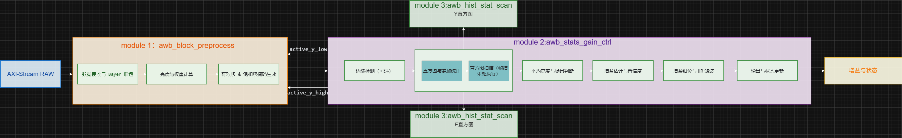
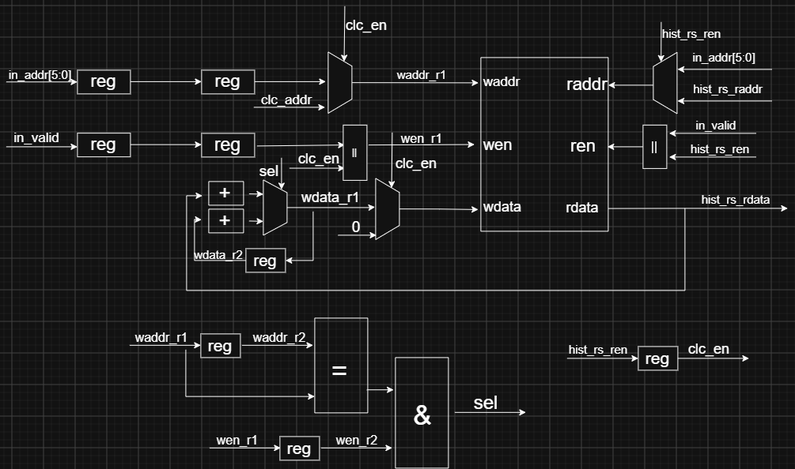

# AWB算法模块

---

## 1. 设计概述

### 1.1 功能

- 接收 Bayer RAW 流，协调块预处理、直方图统计/反扫、场景判断和增益估计，帧末最终输出下一帧可用的 Q12 R/G/B 增益、置信度及状态标志

### 1.2 架构

- 模块一：raw数据流入，输出块RGB及块Y，以及对应的掩码和权重
- 模块二：输入块RGB及块Y，进行直方图统计，并且直方图反扫，输出增益系数
- 模块三：实现直方图统计，并且进行直方图反扫，输出求和值和对应的bin值，在模块二中例化

### 1.3 算法原理

#### 1.3.1数据接收与 Bayer 解包

- 输入：4lane，每lane-12bit Bayer 像素流，按行输入。
- 缓存两行像素以形成 2×2 块（一个 Bayer 单元）。
- 根据`bayer_code` 分离出 R、G、B 位置。
- 对于 G 通道，取同一 `Bayer` 单元的两个 G 像素平均值（16-bit 累加后右移 1 位）。
- 对 R、G、B 分别做右移 `stat_shift`（默认 4）得到 8-bit 值。
- 输出3个2block,每block-8bit 平面（`block_r`, `block_g`, `block_b`），每个像素代表一个 2×2 块的对应颜色。

| code | 名称 | 上行(lane0~3) | 下行(lane0~3) |
|---|---|---|---|
| 0 | RGGB | R,G,R,G | G,B,G,B |
| 1 | GRBG | G,R,G,R | B,G,B,G |
| 2 | GBRG | G,B,G,B | R,G,R,G | 
| 3 | BGGR | B,G,B,G | G,R,G,R | 

#### 1.3.2 亮度与权重计算

- 亮度 Y = (R + 2*G + B) >> 2，得到 8-bit。
- 权重：根据当前块所在行号，若小于图像高度的 1/5 则权重为 `top_weight`（默认1），否则为 `normal_weight`（默认2）。该权重用于后续灰度世界求和（加权平均）。

#### 1.3.3 有效块 & 饱和块掩码生成

- 输入：R,G,B (8-bit), Y (8-bit)
- 计算以下条件（均为组合逻辑）：
- `valid_luma`: (Y > active_y_low) && (Y < active_y_high)
- `valid_sat`: max(R,G,B) < sat_th（默认250）
- `valid_rg`: (R << 8) 在 [rg_lo_q8 * G, rg_hi_q8 * G] 之间（防止极端红绿比）
- `valid_bg`: 类似
- `reject_red`: (R4 > G9) && (R2 > B3) // 红色异常
- `reject_blue`: (B4 > G9) && (B2 > R3) // 蓝色异常
- `mask_valid` = valid_luma & valid_sat & valid_rg & valid_bg & !reject_red & !reject_blue
- `mask_sat` = !valid_sat
- 两者均为 1-bit，输出给后续统计。

#### 1.3.4 边缘检测（可选）

- 基于相邻块（水平和垂直）的 R、G、B 差异计算边缘幅度。
- 使用当前块与左侧块（水平相邻）及上方块（垂直相邻）的差分绝对值之和：
- `d_r = |R_cur - R_left| + |R_cur - R_up|`（当上不存在时用自身代替，lane0水平差分为0，lane1水平差分对象对lane0）
- 类似 G、B。
- `edge = (d_r + d_g + d_b) & 0x3FF（10-bit）`，10bit
- 有效边缘块判断：`edge_valid`: (edge > active_e_th) && (Y > 24)（避免暗区边缘）。结果用于边缘统计。

#### 1.3.5 直方图与累加统计

- 对每个有效块（以及边缘有效块）：
- 将 Y 右移 2 位（范围 0~63）作为 Y 直方图索引，`y_hist[bin]++`。
- 将 edge 右移 4 位（范围 0~63）作为边缘直方图索引，`e_hist[bin]++`。
- `edge_valid`: lane0_mask_valid && enable_edge && (edge0 > active_e_th) && (lane0_y > 24)
- `live_count_all`:统计参与直方图统计的块数的数量
- `live_count_valid` ：+= lane0_mask_valid + lane1_mask_valid
- `live_count_edge`: += edge_valid0 + edge_valid1
- `live_count_sat`: += lane0_mask_sat + lane1_mask_sat
- `live_sum_y`: += lane0_y + lane1_y
- `live_gw_r`: += lane0_r * lane0_w * lane0_mask_valid + lane1_r * lane1_w * lane1_mask_valid

#### 1.3.6 直方图扫描（帧结束处执行）

- 扫描 y_hist 和 e_hist，找到累计计数超过一定百分比的 bin：
- `low_target` : 5% * count_all → 找到第一个累计≥`low_target` 的 bin，其值左移2位作为 `found_y_low`。
- `high_target` : 98% * count_all → 同理，对应 `found_y_high`。
- `edge_target` : 75% * count_all → 同理，对应 `found_e_th`，但是需要左移4位。
- `pending_y_low`: min(found_y_low, 24)`
- `pending_y_high`: = max(found_y_high, 220)`
- `pending_e_th` : max(8, min(160, found_e_th))`
- 这些值将作为下一帧的 `pending_y_low/high` 和 `pending_e_th`（动态适应场景）。

#### 1.3.7 平均亮度与场景判断

- 根据 sum_y 和 count_all 计算 mean_y_cur（映射为 16/48/96/160 四个离散值）：
- 若 `snap_count_all == 0`  → 0
- 若 `snap_sum_y < (snap_count_all << 5)` → 16
- 若 `snap_sum_y < (snap_count_all << 6)` → 48
- 若 `snap_sum_y < (snap_count_all << 7)` → 96
- 否则 → 160
- `dark_scene`:  snap_count_all != 0 and snap_sum_y < (snap_count_all << 5) 
- `valid_ratio_pm` :(snap_count_valid * 1000) // snap_count_all if snap_count_all != 0 else 0

#### 1.3.8 增益估计与置信度

- 原始增益（未钳位）：
- `raw_target_gr = (snap_gw_g << 12) / snap_gw_r` （若 snap_gw_g == 0 || snap_gw_r == 0 则保持前一帧）
- `raw_target_gb = (snap_gw_g << 12) / snap_gw_b`
- 计算置信度`conf_sog` `conf_edge`:基于 `count_valid/count_all*1000` 比例（阈值 600/200/5 ）得到 3/2/1/0。
- `conf_sog`:conf_from_ratio(snap_count_valid, snap_count_all, 600, 200, 5)
- `conf_edge`:conf_from_ratio(snap_count_edge, snap_count_all, 400, 100, 20) if enable_edge else 0
- 置信度减小(dec_conf)：需要考虑置信度为0时的情况
- 若 `snap_count_all != 0 and (snap_count_sat * 1000) > (snap_count_all * 150)`:next_conf_sog = dec_conf(next_conf_sog)
- 若`dark_scene`:next_conf_edge = dec_conf(next_conf_edge)
- `scene_dominant`:(raw_target_gr > GAIN_TARGET_TRUST_Q12) && (raw_target_gb > GAIN_TARGET_TRUST_Q12) && (valid_ratio_pm < LOW_CONF_VALID_RATIO_PM)
- `scene_change`：abs(mean_y_cur - prev_mean_y) > 24 or abs(est_gr_q12 - prev_gr_q12) > (prev_gr_q12 >> 3) or abs(est_gb_q12 - prev_gb_q12) > (prev_gb_q12 >> 3),场景变化标志

#### 1.3.9 增益钳位与 IIR 滤波

- `target_gr`: clamp(raw_target_gr)，target_gb 同理。根据当前的红绿增益和蓝绿增益估计下一帧的增益，并将其钳制在最小0.5倍到最大3倍之间
- `est_gr_q12``est_gb_q12`若 next_conf_sog >= 1，使用钳位后的 target_gr/gb 作为估计值，否则使用前一帧增益。
- `beta_shift` : 2 if scene_change else (5 if next_conf_sog == 0 else 4) ，
- `iir_gr` : prev_gr + (est_gr - prev_gr) >> beta_shift，iir_gb 同理。
- `delta_gr` : prev_gr >> 4
- `pending_gr`:clamp( max(prev_gr_q12 - delta_gr, min(prev_gr_q12 + delta_gr, iir_gr_q12))),限制每帧最大变化量。
- 最终输出 `pending_gr_q12`, `pending_gb_q12`，同时 gg_gain(绿增益) 保持 4096。（Q12表示）

#### 1.3.10 输出与状态更新

- `hold`:next_conf_sog == 0
- 将计算的 `pending_gr/gb` 作为本帧输出。
- 将 `pending_y_low/high`, `pending_e_th` 作为下一帧配置。
- 将 `conf_sog`, `conf_edge`, `hold`, `scene_change` 等状态输出供外部读取。
- 更新内部寄存器（前一帧增益、平均亮度等）用于下一帧。

---

### 1.4 参数定义

#### 1.4.1 动态参数

| 信号名                  | 位宽              | 方向  | 默认值 | 说明  |
| ---------------------- | --------------- | --- | --- | --- |
| `bayer_pattern`        | 2               | 输入  |2'b11| 动态，Bayer 排布  |
| `img_width`            | 16              | 输入  |1920 | 动态，图像宽度（水平像素数） |
| `img_height`           | 16              | 输入  |1280 | 动态，图像高度（垂直行数）|
| `soft_rst`             | 1               | 输入  |1'b0 | 动态，软复位|
| `edge_en`              | 1               | 输入  |1'b0 | 动态，边缘统计使能|
| `rg_lo_q8`             | 16              | 输入  | 115 | 动态，R/G 比值窗口下界|
| `rg_hi_q8`             | 16              | 输入  | 563 | 动态，R/G 比值窗口上界
| `bg_lo_q8`             | 16              | 输入  | 115 | 动态，B/G 比值窗口下界|
| `bg_hi_q8`             | 16              | 输入  | 563 | 动态，B/G 比值窗口上界|
| `sat_th`               | 8               | 输入  | 250 | 动态，过饱和判据|
| `top_weight`           | 4               | 输入  | 1   | 动态，顶部（天空/背景）区域分块的统计权重  |
| `normal_weight`        | 4               | 输入  | 2   | 动态，顶部以外主体区域分块的统计权重  |
| `conf_sog_strong_pm`   | 12              | 输入  | 600 | 动态，灰度世界置信度分级：强|
| `conf_sog_med_pm`      | 12              | 输入  | 200 | 动态，灰度世界置信度分级：中|
| `conf_sog_weak_pm`     | 12              | 输入  | 5   | 动态，灰度世界置信度分级：弱|
| `conf_edge_strong_pm`  | 12              | 输入  | 400 | 动态，边缘置信度分级：强|
| `conf_edge_med_pm`     | 12              | 输入  | 100 | 动态，边缘置信度分级：中 |
| `conf_edge_weak_pm`    | 12              | 输入  | 20  | 动态，边缘置信度分级：弱 |

#### 1.4.2 静态参数

| 信号名                      | 默认值   |说明|
| ------------------------ | ----- |--------|
| `HIST_BINS`              | 64    |亮度/边缘直方图箱数|
| `Y_BIN_SHIFT`            | 2     |亮度直方图取箱右移位数|
| `E_BIN_SHIFT`            | 4     |边缘直方图取箱右移位数|
| `EDGE_Y_TH`              | 24    |边缘统计的最低亮度门限|
| `GAIN_MIN_Q12`           | 2048  |R/B 通道白平衡增益 gr/gb 的下限|
| `GAIN_MAX_Q12`           | 12288 |R/B 通道白平衡增益 gr/gb 的上限|
| `GAIN_TRUST_Q12`         | 7373  |强单色场景判定阈值|
| `LOW_CONF_RATIO_PM`      | 400   |有效样本占比下限|
| `BLOCKS_PER_CYCLE`       | 2     |每周期并行统计的 2×2 分块数|
| `COORD_WIDTH`            | 16    |分块坐标位宽|
| `DATA_WIDTH_IN`          | 12    |Bayer 采样前统计支路的数据位宽|
| `DATA_WIDTH_OUT`         | 8     |分块 R/G/B 与亮度 Y 的统计位宽|
| `STAT_SHIFT`             | 4     |降采样的右移位数|
| `Y_BIN_VAL_LOW`          | 16    |亮度分桶 - 低亮度档位|
| `Y_BIN_VAL_MID_LOW`      | 48    |亮度分桶 - 中低亮度档位|
| `Y_BIN_VAL_MID_HIGH`     | 96    |亮度分桶 - 中高亮度档位|
| `Y_BIN_VAL_HIGH`         | 160   |亮度分桶 - 高亮度档位|
| `IIR_SHIFT_SCENE_CHANGE` | 2     |场景变化时 IIR 移位（快跟踪）|
| `IIR_SHIFT_LOW_CONF`     | 5     |低置信时 IIR 移位（慢跟踪）|
| `IIR_SHIFT_NORMAL`       | 4     |正常 IIR 移位|
| `Y_HIST_LOW_DEFAULT_RET` | 4     |found_y_low 扫描失败默认返回值|
| `Y_HIST_HIGH_DEFAULT_RET`| 250   |found_y_high 扫描失败默认返回值|
| `E_HIST_TH_DEFAULT_RET`  | 24    |found_e_th 扫描失败默认返回值|
| `Y_LOW_CLAMP_MAX`        | 24    |pending_y_low 钳位上限|
| `Y_HIGH_CLAMP_MIN`       | 220   |pending_y_high 钳位下限|
| `E_TH_CLAMP_MIN`         | 8     |pending_e_th 钳位下限|
| `E_TH_CLAMP_MAX`         | 160   |pending_e_th 钳位上限|

- `E_TH`中间参数，初始值为24，边缘幅度阈值（ >E_TH 计为有效边缘块）；帧末自适应更新（8~160）

---

## 2.设计要点

### 2.1 IP核的设置

#### 2.1.1 BRAM

- 进行Bayer解包时行缓存主要采用的是一个单端口RAM，当为偶数行，进行写入数据，当为奇数行，进行读取数据，数据宽度为DATA_WIDTH_IN*4，数据深度为IMG_WIDTH/4，这里按512来计，选取的参数为`512*48`
- 进行边缘检测时行缓存采用一个简单双端口实现行缓存，rgb三个通道合在一起，数据位宽为`BLOCKS_PER_CYCLE*DATA_WIDTH_OUT*3`，深度为IMG_WIDTH/4，按照512处理，则选取的参数为`512*48`
- 直方图统计分为亮度和边缘两个部分，每个部分采用两个简单双端口，数据位宽为`clog2（IMG_WIDTH*IMG_HEIGHT/4/2）`，即19位，深度为64，这里选取的参数为`64*19`
- 由于都采取`Primitives Output Register`，故读取均为两拍

#### 2.1.2 除法器

- 计算`valid_ratio_pm`，设置high-Radix算法(必须设置符号位)，42位除以24位，考虑符号位后，43位除以25位，设置为输出没有余数
- 计算`raw_target_gr_q12`，`raw_target_gb_q12`，设置high-Radix算法(必须设置符号位)，44位除以32位，考虑符号位后，45位除以33位，设置为输出没有余数

---

### 2.2 直方图统计

- 采用两个简单双端口实现，分别统计lane0和lane1，直方图反扫阶段将读数结果汇总
- 在不考虑软复位时，直方图统计和直方图反转如图所示

---

添加部分说明
- bayer部分只按bggr来算（暂未考虑）
- 添加了软复位完成标志，初始值为1，软复位有效时，软复位完成标志为0，若clc_addr='d63时，且软复位低电平时，则软复位完成有效